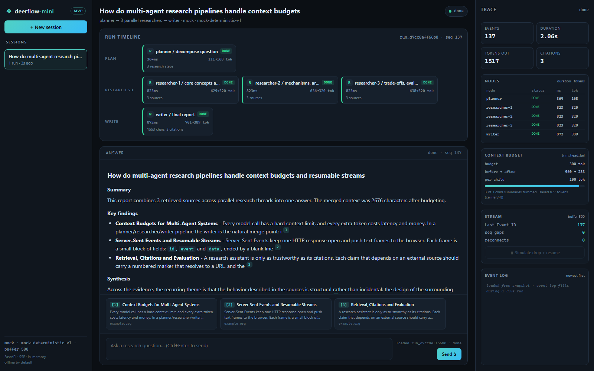
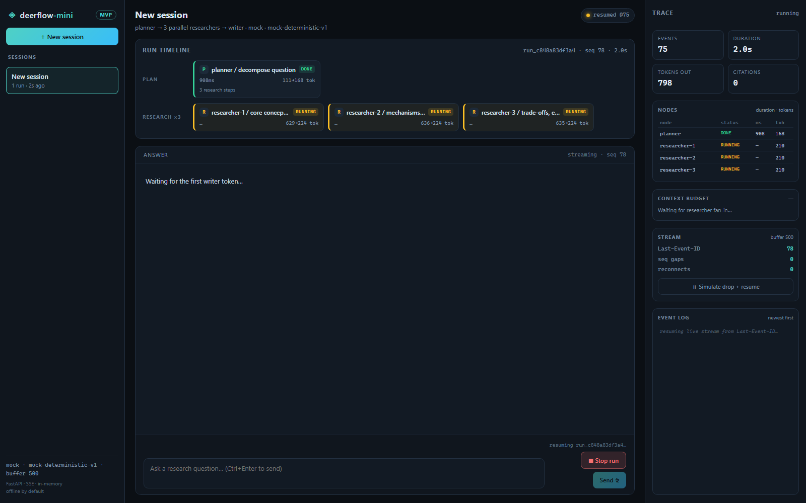

# deerflow-mini

A small, self-contained reproduction of the DeerFlow research workflow:
**planner -> N parallel researchers -> writer**, with a resumable SSE event
stream, real task cancellation, a tool registry with permission isolation, a
context budget between agents, and a no-build single-page UI.

- Backend: FastAPI + asyncio (no LangGraph / LangChain)
- Frontend: plain HTML/CSS/JS mounted with `StaticFiles` (no npm)
- LLM: deterministic offline `mock` provider by default; optional
  OpenAI-compatible streaming provider
- Port: **8201**
- Run artifacts: 137 events, ~2.1 s end to end, 3 citations, no API key needed



## Quick start

From this directory (`replicas\01-deerflow-mini`), with the shared venv already
installed at `..\.venv`:

```powershell
# one command (Windows PowerShell blocks unsigned scripts by default)
powershell -NoProfile -ExecutionPolicy Bypass -File .\run.ps1
```

or directly:

```powershell
..\.venv\Scripts\python.exe -m uvicorn app.main:app --host 127.0.0.1 --port 8201
```

Then open <http://127.0.0.1:8201/>. The mock LLM needs no key and no network.
Stop the server with `Ctrl+C`.

Requires Python 3.12 and the packages in `requirements.txt` (already present in
the shared venv; measured versions: fastapi 0.162.5, uvicorn 0.54.0,
httpx 0.28.1, pydantic 2.14.3, starlette 1.10.0).

## Architecture

```
                         POST /api/runs {session_id, query}
                                      |
                         +------------v-------------+
                         |       Orchestrator       |  one asyncio task per run
                         |  explicit state machine  |
                         +------------+-------------+
                                      |
                         +------------v-------------+
                         | planner   (LLM stream)   |  node_start/token/node_end
                         +------------+-------------+
                                      |  asyncio.gather (cancellation fans out)
              +-----------------------+-----------------------+
              |                       |                       |
     +--------v--------+     +--------v--------+     +--------v--------+
     |  researcher-1   |     |  researcher-2   |     |  researcher-3   |
     | web_search      |     | web_search      |     | web_search      |
     | fetch_url       |     | fetch_url       |     | fetch_url       |
     | LLM summary     |     | LLM summary     |     | LLM summary     |
     +--------+--------+     +--------+--------+     +--------+--------+
              +-----------------------+-----------------------+
                                      |
                    context budget: trim_head_tail, 300 tokens
                    (child summaries -> bounded merged notes)
                                      |
                         +------------v-------------+
                         | writer    (LLM stream)   |  token events -> answer
                         +------------+-------------+
                                      |
                         EventBus: seq++, ring buffer (500 events), fan-out
                                      |
              GET /api/runs/{id}/events  (SSE)  <-- Last-Event-ID replay
                                      |
                         static SPA (app/static, no build step)
```

Node state machine: `pending -> running -> done | failed | cancelled`.
Every transition is an event; the event log is the single source of truth for
the UI timeline and trace panel.

## Event model and resumable SSE

Each run owns an `EventBus`. `publish()` is synchronous, assigns the next
per-run `seq`, appends to a bounded ring buffer (default **500** events) and
fans the event out to live subscriber queues. Because replay and subscribe
happen without an `await` in between, there is no replay/live race.

Event types:

| type | meaning |
| --- | --- |
| `run_start` | run accepted, provider/model/researcher count |
| `node_start` / `node_end` | node state transitions, duration, token counts, detail |
| `token` | one streamed LLM chunk (`channel`: `plan` / `research` / `answer`) |
| `tool_call` / `tool_result` | tool name, args, duration, result summary |
| `citation` | numbered source (`index`, `title`, `url`, `snippet`, researcher) |
| `context_trim` | context-budget policy and before/after token counts |
| `run_end` | terminal event for done/failed runs (includes final answer + metrics) |
| `run_cancelled` | terminal event for cancelled runs (partial answer + cancelled nodes) |
| `stream_reset` | client asked for an event already evicted from the ring buffer |

SSE frames use the standard `id`, `event`, `data` fields:

```
id: 1
event: run_start
data: {"seq":1,"run_id":"run_...","type":"run_start","ts":...,"query":"...","provider":"mock",...}

id: 2
event: node_start
data: {"seq":2,...,"node_id":"planner","label":"planner / decompose question","kind":"planner","status":"running"}
```

Clients may resume with either `?last_event_id=N` or the standard
`Last-Event-ID: N` header (header wins). The server replays every buffered event
with `seq > N`, then switches to live delivery, and closes the response after
the terminal event. If `N` is older than the oldest buffered seq, it first sends
`event: stream_reset` with `oldest_seq`; the SPA resets local state and rebuilds
from the replay.

## Cancellation

`POST /api/runs/{id}/cancel` is not a flag:

1. the stored `asyncio.Task` for the run is cancelled;
2. `CancelledError` unwinds through `asyncio.gather`, cancelling all
   researcher coroutines, and through the streaming LLM async generator (the
   mock sleeps at a real await point; the OpenAI-compatible provider iterates
   `httpx` response lines inside `async with`, so the HTTP stream is closed);
3. running nodes are closed with `node_end status=cancelled`;
4. a terminal `run_cancelled` event is published, including
   `cancelled_nodes`, `cancel_latency_ms`, `tokens_before_cancel` and the
   partial answer;
5. the SSE response ends after that event.

Measured with the writer streaming: writer stopped after 279.3 ms with 126 of
389 output tokens emitted, partial answer 504 chars, terminal `run_cancelled`,
`cancel_latency_ms` 0.0 ms (1.48 ms in another run).

## Context budget

Before the writer sees child summaries, `app/context.py` fits them into
`CONTEXT_TOKEN_BUDGET` (default 300) using `CONTEXT_STRATEGY`:

- `trim_head_tail` (default): per-child budget = `budget // n`; longer
  summaries keep 70% of the prefix and 30% of the suffix plus an inline
  trimming marker; the joined text is trimmed again if needed.
- `truncate`: hard cut per child.
- `none`: keep child text but still cap the joined text.

Tokens are estimated as `ceil(len(text)/4)` (no tokenizer dependency). The run
trace stores the policy name, budget, per-child budget, tokens before/after,
number of trimmed items and tokens saved; the same values are emitted as a
`context_trim` event.

Measured for the reference run: 960 tokens of child summaries -> 283 tokens
merged notes (budget 300, 3/3 children trimmed, 677 tokens saved).

## Tools and permissions

`app/tools.py` has a small registry (`net.web_search`, `net.fetch_url`). Each
tool declares a permission namespace; each agent call passes allowed permission
prefixes, and `registry.invoke()` rejects calls outside them before executing
the tool.

- `web_search`: case-insensitive keyword search over the 6 markdown documents
  in `corpus/`, weighted by title, tags and body term frequency.
- `fetch_url`: offline mode resolves the URL back to the cached corpus document
  and returns its full text. `OFFLINE=0` enables a real httpx fetch (not
  exercised by the offline test setup).

Researchers are allowed `["net"]`; planner and writer are allowed `[]`. A
direct call as writer raises `ToolPermissionError` (asserted in
`scripts/inproc_check.py`).

## LLM providers

`LLM_PROVIDER=mock` (default): deterministic sentence generation from the
structured prompt markers, streamed in chunks with `asyncio.sleep` between
them. It is offline, needs no key, and makes the system testable.

`LLM_PROVIDER=openai`: any OpenAI-compatible endpoint, streamed with httpx:

```powershell
$env:LLM_PROVIDER='openai'
$env:LLM_BASE_URL='https://api.example.com/v1'
$env:LLM_API_KEY='...'
$env:LLM_MODEL='gpt-4o-mini'
.\run.ps1
```

The prompts are written as readable instructions plus structured markers, so a
real model receives usable text. Only the mock path is covered by the recorded
tests (no API key was used).

## HTTP API

| Method | Path | Description |
| --- | --- | --- |
| POST | `/api/sessions` | create session (`{"title": "..."}` optional) |
| GET | `/api/sessions` | list sessions with run summaries |
| GET | `/api/sessions/{id}` | session detail + conversation history |
| POST | `/api/runs` | start a run: `{"session_id": "...", "query": "..."}` |
| GET | `/api/runs?session_id=` | list runs (newest first) |
| GET | `/api/runs/{id}` | run snapshot (nodes, citations, metrics, last_event_id) |
| POST | `/api/runs/{id}/cancel` | request cancellation and wait for the task |
| GET | `/api/runs/{id}/trace` | node durations/tokens, context budget, buffer state |
| GET | `/api/runs/{id}/events?last_event_id=N` | SSE stream with replay (also honors `Last-Event-ID`) |
| GET | `/api/health` | provider, tools, buffer capacity, counters |
| GET | `/` | static single-page UI |

Example (PowerShell): `curl.exe` on Windows needs the JSON body in a file to
avoid quote mangling.

```powershell
# create a session
curl.exe -s -X POST http://127.0.0.1:8201/api/sessions -H "Content-Type: application/json" -d "{}"

# start a run
'{"session_id":"sess_...","query":"How do multi-agent pipelines handle context budgets?"}' |
  Set-Content -NoNewline .\body.json
curl.exe -s -X POST http://127.0.0.1:8201/api/runs -H "Content-Type: application/json" --data-binary "@body.json"

# stream the run (disable buffering with -N)
curl.exe -N "http://127.0.0.1:8201/api/runs/run_.../events?last_event_id=0"

# resume after a dropped connection
curl.exe -N -H "Last-Event-ID: 110" "http://127.0.0.1:8201/api/runs/run_.../events"

# cancel
curl.exe -s -X POST http://127.0.0.1:8201/api/runs/run_.../cancel
```

Error paths: missing session/run -> 404; empty query -> 422; cancelling an
already terminal run returns `already_terminal: true` without side effects.
An unknown tool call or a permission violation fails the calling node and ends
the run as failed.

## Frontend

Single static page in `app/static` (no bundler, no framework):

- session list + new session, conversation input, Ctrl+Enter submit;
- live run timeline: planner, three parallel researchers, writer with
  `running/done/failed/cancelled` states, live elapsed time and token counts;
- streamed answer with clickable `[n]` citation superscripts and citation cards;
- trace panel: event count, duration, tokens out, citations, per-node table,
  context-budget bar, `Last-Event-ID`, seq-gap counter, reconnect counter and a
  live event log;
- cancellation button while a run is active;
- "Simulate drop + resume" closes the EventSource manually and reconnects with
  the last sequence number, exercising the replay path from the browser.



## Measured results

Environment: Windows 11, Python 3.12, shared venv, mock LLM, offline,
`EVENT_BUFFER_SIZE=500`, 3 researchers, `CONTEXT_TOKEN_BUDGET=300`.
Recorded 2026-11-13 against the running server on port 8201.

| Metric | Measured value |
| --- | --- |
| events per completed run | **137** (`seq 1..137`, contiguous) |
| end-to-end run duration | **2059.3 ms** (second run: 2143.4 ms) |
| planner | 364.3 ms (second run: 468.1 ms) |
| researcher-1 / -2 / -3 | 822.9 ms each, running in parallel (second run: 802.2 ms) |
| writer | 872.0 ms (second run: 873.0 ms) |
| token events | 109 |
| tokens in / out (estimated) | 2712 / 1517 |
| writer output tokens | 389 |
| citations | 3 |
| answer length | 1553 chars |
| context budget | 960 -> 283 tokens (budget 300, 3/3 trimmed, 677 saved) |
| tool calls / results | 6 / 6 |
| ring buffer | capacity 500, buffered 137 |
| SSE disconnect test | cut at seq 110 after 1 s (`--max-time 1`, 30,709 bytes); reconnect with `Last-Event-ID: 110` replayed 29 events (`seq 111..139`, 8,351 bytes), contiguous, ended with `run_end` |
| cancellation test | cancelled at 1.4 s: 116 events, writer cancelled after 279.3 ms with 126 tokens, partial answer 504 chars, terminal `run_cancelled` (`cancel_latency_ms` 0.0; 1.48 ms on another run) |
| buffer-eviction test | with a temporary `EVENT_BUFFER_SIZE=20`, replay from 0 emitted `stream_reset` (`oldest_seq=114`) followed by the 20 buffered events |

Numbers vary a few percent run to run because the mock stream sleeps per chunk
and Windows timer granularity is ~15.6 ms. The mock pacing floors its delay at
20 ms so a "stream" never collapses into a single burst.

## Self-verification

Start the server first (see Quick start), then:

```powershell
# deterministic in-process orchestration check (seq continuity, node durations,
# context budget, cancellation, tool permission isolation)
..\.venv\Scripts\python.exe scripts\inproc_check.py

# HTTP end-to-end check: full run, real disconnect + Last-Event-ID resume,
# cancel mid-writer with assertions
..\.venv\Scripts\python.exe scripts\verify_http.py
```

Recorded curls (abridged):

```
$ curl.exe -N "http://127.0.0.1:8201/api/runs/run_d7cc8eff66b8/events?last_event_id=0"
: deerflow-mini stream seq=0

id: 1
event: run_start
data: {"seq":1,"run_id":"run_d7cc8eff66b8",...,"provider":"mock","researcher_count":3,...}

id: 2
event: node_start
data: {"seq":2,...,"node_id":"planner","label":"planner / decompose question",...}

id: 3
event: token
data: {"seq":3,...,"node_id":"planner","text":"{\"steps\": [...","channel":"plan",...}

...

id: 137
event: run_end
data: {"seq":137,...,"status":"done","duration_ms":2059.3,...}
```

```
$ curl.exe -N --max-time 1 ".../events?last_event_id=0"    # drops after 1 s
# 110 events captured, last id: 110

$ curl.exe -N -H "Last-Event-ID: 110" ".../events"
: deerflow-mini stream seq=110

id: 111
event: token
data: {"seq":111,...,"node_id":"writer","text":"stration Patterns** - Multi-agent...","channel":"answer",...}
# ... 29 events total, seq 111..139, contiguous, terminal run_end
```

```
$ curl.exe -s -X POST ".../api/runs/run_64b3a23bbbcf/cancel"
{"run":{...,"status":"cancelled","nodes":[...,{"id":"writer","status":"cancelled",...}]},
 "cancel_requested":true,"already_terminal":false,"task_cancelled":true}

$ curl.exe -N ".../api/runs/run_64b3a23bbbcf/events?last_event_id=0" | tail
id: 115
event: node_end
data: {"seq":115,...,"node_id":"writer","status":"cancelled","detail":"cancelled by user"}

id: 116
event: run_cancelled
data: {"seq":116,...,"status":"cancelled","cancelled_nodes":["writer"],
       "cancel_latency_ms":0.0,...,"partial_answer":"# Cancel while ..."}
```

## Differences from the original DeerFlow

This is an independent reproduction of the architecture, not a clone:

| Area | deer-flow | deerflow-mini |
| --- | --- | --- |
| orchestration | LangGraph-style graph/team | explicit asyncio state machine, no framework |
| agents | research team with sub-agents and configurable roles | fixed planner -> 3 researchers -> writer |
| tools | web search / crawler integrations | local markdown corpus + cached fetch, offline by default |
| persistence | durable runs, checkpointing | in-memory sessions/runs; restart loses state |
| storage | database / files | bounded in-memory event ring (500) |
| streaming | SSE / streaming endpoints | SSE with per-run `seq` and explicit `Last-Event-ID` replay + reset |
| frontend | React app, build toolchain | static HTML/CSS/JS served by FastAPI, no build |
| deployment | services + infra | single Python process on port 8201 |
| LLM | hosted models | deterministic mock by default, OpenAI-compatible optional |

## Known limitations

- State is in memory: restarting the server loses sessions, runs and event
  buffers.
- The event buffer holds the last 500 events per run. A client that reconnects
  with a very old `Last-Event-ID` gets `stream_reset` and can only rebuild from
  the buffered tail; the SPA does that, but events older than the buffer are
  gone.
- Single process only: fan-out uses in-process `asyncio.Queue`, so multiple
  uvicorn workers would each have their own state. No Redis/pub-sub.
- The corpus sources use `example.org` URLs and are illustrative; the mock
  answers are deterministic but not real research.
- The OpenAI-compatible provider is implemented but was not exercised in the
  recorded verification (no key was available); cancellation propagation through
  httpx is by-construction (context-managed stream) rather than measured.
- Planner output is a single LLM call; malformed JSON falls back to three
  angle-based sub-questions. There is no reflection/replanning loop.
- No authentication, authorization, rate limiting, CORS policy or multiuser
  isolation. Do not expose the server publicly.
- No automated answer-quality evaluation; tests assert orchestration mechanics
  (event sequence, resumption, cancellation, budget accounting), not truth.
- Mock pacing depends on `asyncio.sleep`; on Windows the event loop timer
  granularity (~15.6 ms) can service sub-tick sleeps immediately, so the mock
  floors its delay at 20 ms. Real LLM timing is network-bound.
- The SPA implements manual EventSource reconnects with an explicit
  `last_event_id`; native browser automatic reconnection (which would send
  `Last-Event-ID` itself) is supported by the server but is not separately
  tested in a real browser.

## Layout

```
01-deerflow-mini/
  run.ps1                  # one-command start (uses ..\.venv python)
  requirements.txt         # fastapi / uvicorn / httpx
  README.md
  app/
    main.py                # FastAPI routes, SSE endpoint, static mount
    orchestrator.py        # planner -> researchers -> writer, node state machine
    events.py              # per-run seq counter, ring buffer, fan-out, SSE frames
    llm.py                 # mock + OpenAI-compatible streaming providers
    context.py             # token budget / trimming policy
    tools.py               # tool registry, permission prefixes, offline tools
    store.py               # in-memory sessions and runs
    config.py              # env-driven settings
    static/
      index.html           # single-page UI shell
      styles.css
      app.js               # SSE client, timeline, answer, trace panel
  corpus/                  # 6 markdown documents for offline web_search/fetch_url
  scripts/
    inproc_check.py        # in-process assertions + metrics
    verify_http.py         # live HTTP end-to-end verification
  docs/
    screenshot.png
    screenshot-live.png
```

## Configuration

All settings are environment variables:

| Variable | Default | Meaning |
| --- | --- | --- |
| `HOST` / `PORT` | `127.0.0.1` / `8201` | bind address |
| `EVENT_BUFFER_SIZE` | `500` | per-run event ring buffer |
| `SSE_HEARTBEAT_SECONDS` | `10` | comment heartbeat interval on idle streams |
| `LLM_PROVIDER` | `mock` | `mock` or `openai` |
| `LLM_BASE_URL` / `LLM_API_KEY` / `LLM_MODEL` | OpenAI defaults / empty / `gpt-4o-mini` | OpenAI-compatible endpoint |
| `MOCK_TOKEN_DELAY` / `MOCK_TOKEN_CHARS` | `0.025` / `56` | mock stream pacing (delay floored at 20 ms) |
| `RESEARCHER_COUNT` | `3` | parallel researchers |
| `CONTEXT_TOKEN_BUDGET` | `300` | merged child-summary budget |
| `CONTEXT_STRATEGY` | `trim_head_tail` | `trim_head_tail` / `truncate` / `none` |
| `MAX_TOKENS_PLANNER` / `_RESEARCHER` / `_WRITER` | `320` / `320` / `700` | per-call output caps |
| `OFFLINE` | `1` | offline tools (strict corpus) |
| `FETCH_TIMEOUT_SECONDS` | `8` | online fetch timeout |

## Notes on the implementation

- No Chinese identifiers in code; labels/messages are English.
- No hard-coded absolute paths; `run.ps1` resolves the venv relative to itself.
- No extra pip dependencies beyond fastapi/uvicorn/httpx.
- `scripts/inproc_check.py` and `scripts/verify_http.py` are the executable
  evidence behind the measured numbers above.
